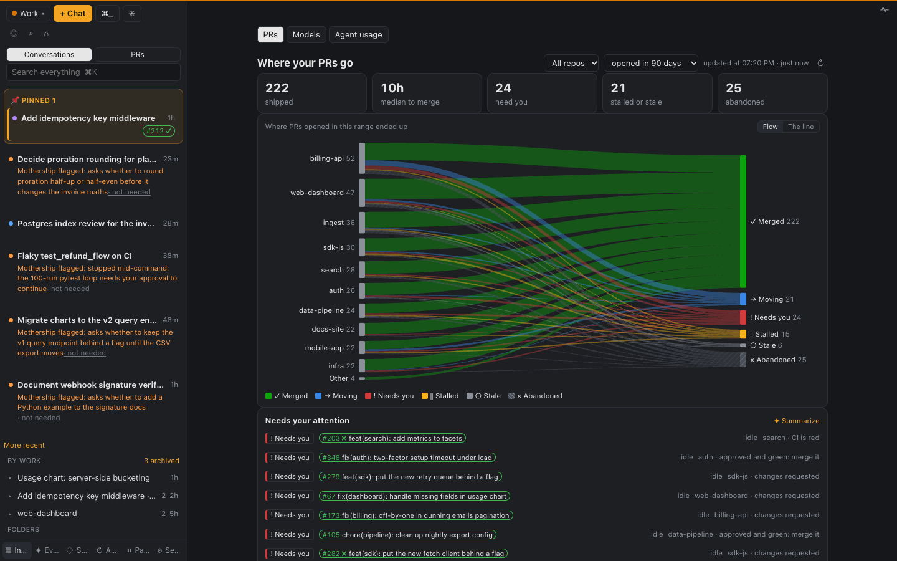
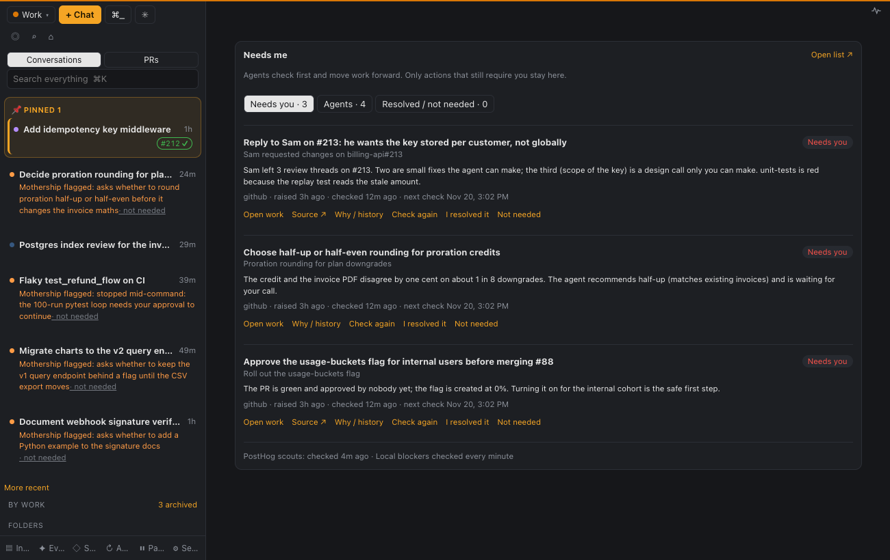
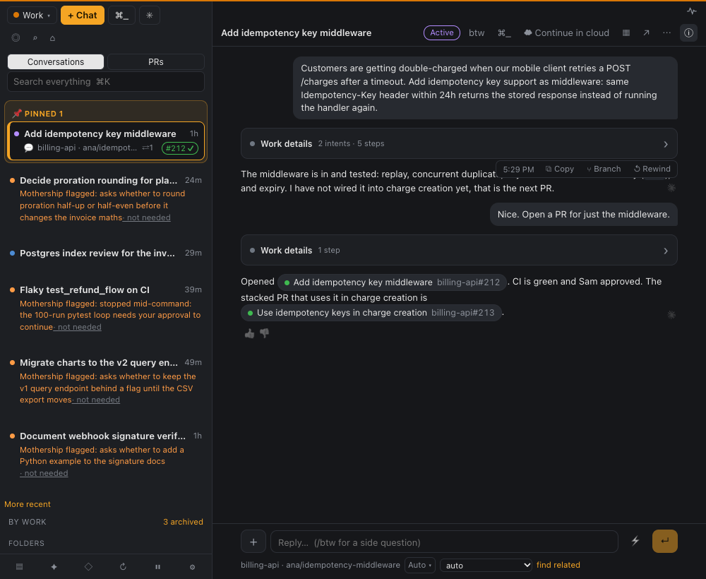
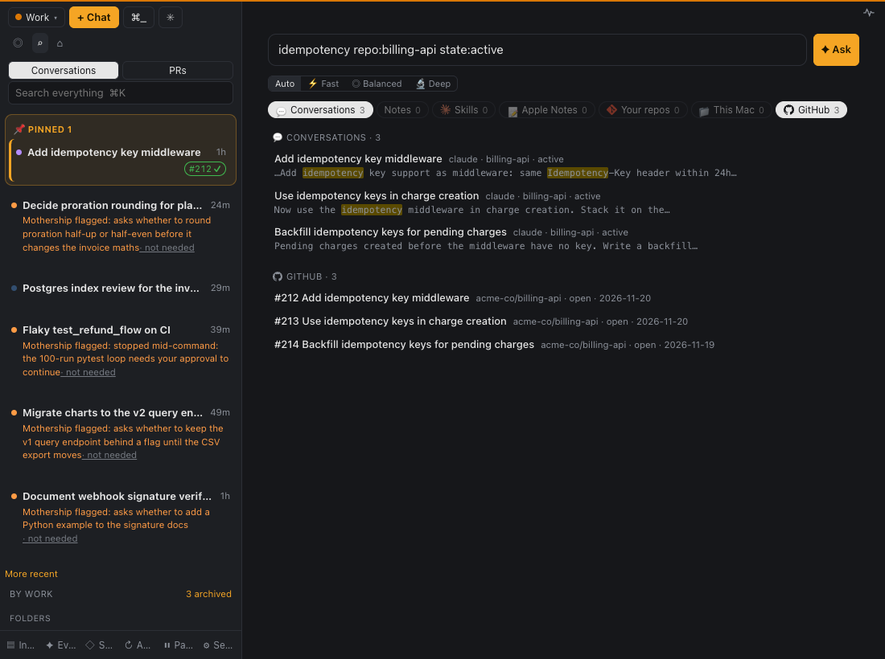
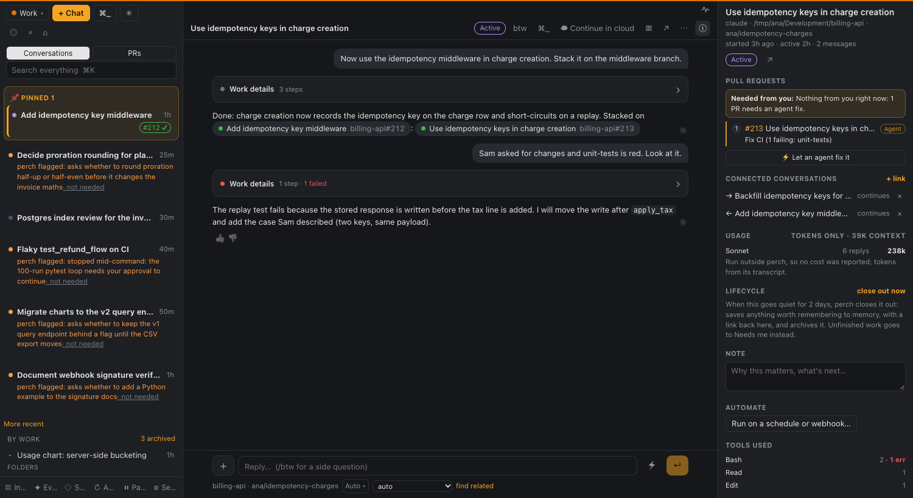
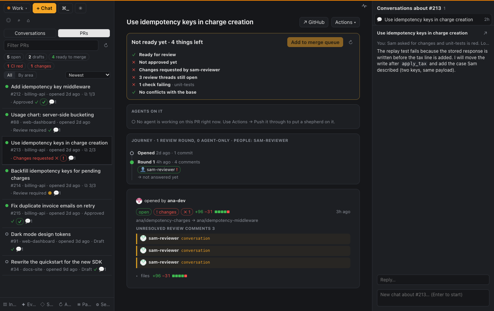
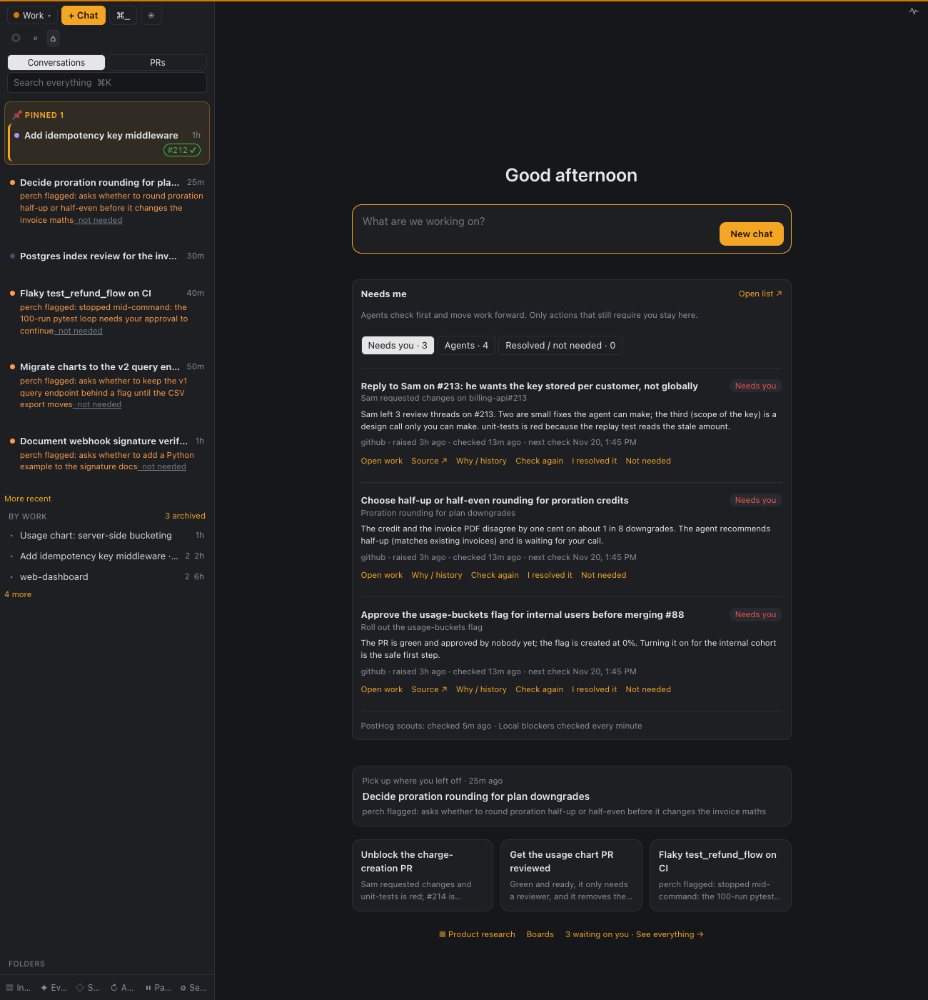
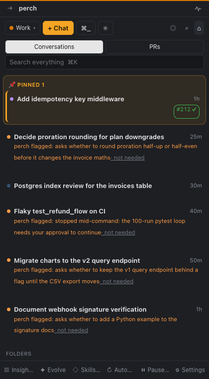
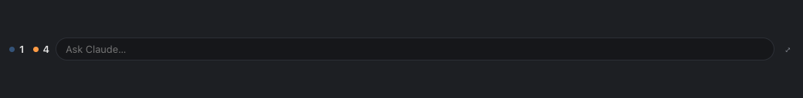
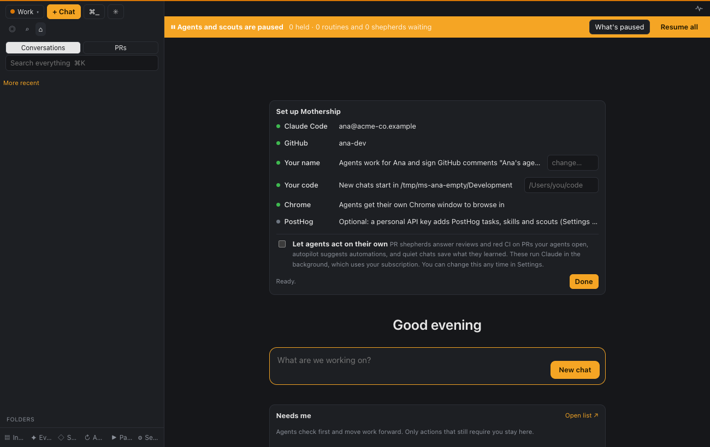

<div align="center">

# auto-m8

**Debottleneck yourself. Your agents write code in parallel; auto-m8 gets it reviewed, merged and checked in production, and only asks you for decisions.**

[](https://github.com/DanielVisca/auto-m8/actions/workflows/ci.yml)
[](LICENSE)




<sub>Every PR you and your agents opened, where it ended up, and the ones that need you. Click an area or outcome to list those PRs, then summarize them.</sub>

</div>

Agents can write code in parallel. You can't review it, unblock it, merge it and check it in production in parallel, so your output is capped by you. auto-m8 is built to debottleneck that: it takes you out of every step that isn't a decision.

- **No agent starts from zero.** Every chat can search, read and message every other chat and the PRs behind them.
- **PRs finish without you pushing them.** A shepherd carries each one through review threads, red CI, merge order, the merge itself and a production check.
- **You only see what needs you.** Questions, red CI, changes requested and stalls surface; everything else stays quiet.

auto-m8 brings all your coding-agent chats into one place, and gives each one the context of the others. It reads the Claude Code and Cursor chats you already have and runs new chats on Claude Code or Codex. Every chat can search, read and message every other one, so an agent picks up where the last one left off instead of starting from zero.

It sits on top of the tools you already use ([Claude Code](https://docs.anthropic.com/en/docs/claude-code/setup), [Codex](https://github.com/openai/codex), `gh`, your own MCP servers and skills) and builds no connectors of its own. Your chats, code and prompts never leave your Mac through auto-m8: chats run the real `claude` and `codex` CLIs on your own login, so `claude --resume` works on every Claude chat.

## Why I built it: one bottleneck at a time

I started auto-m8 on 5 Nov 2026. In the ten weeks before that I merged 4 to 18 PRs a week on GitHub, usually about 14. In the two weeks after, I merged 109 and then 156. Models also got better over the same stretch, so not all of that is auto-m8. Most of what I got back came from removing these blocks, roughly in the order I hit them:

|  | **The block** | **What removed it** |
| --- | --- | --- |
| 🧠 | **I was the only thing carrying context between agents.** Every new chat started from zero. | Every chat can search, read and message every other chat. Agents hand work to each other (`delegate`) instead of through me. |
| 🚧 | **I was the PR babysitter.** Every PR waited on me to answer reviewers, fix red CI, remember merge order and check production. | The **PR shepherd** answers review threads and red CI, merges when the PR's plan allows, then checks production against the plan and opens a revert PR on a regression. |
| ⏳ | **Hitting my plan's limit stopped work.** | **Smart use of the subscription:** Auto picks the model per ask (Haiku for quick asks, Sonnet for normal work, Opus for heavy thinking) and paces each plan's allowance to its reset date. When a model hits its cap, the chat moves down a tier, to Codex, to a cloud task or to a **local model** (Ollama) and keeps its context. **Shadow replays** re-run shipped PRs on cheaper models to show where the expensive one wasn't needed. |
| 🧊 | **Agents died quietly and I found out hours later.** | Stalled chats get nudged to carry on, and `follow_up` timers wake an agent when a PR merges or a deploy lands. |
| 🔔 | **I checked six windows to find out who was waiting on me.** | **Needs me**: only real signals (a question, red CI, changes requested, a failed task). |
| 🔁 | **I kept asking for the same things.** | **Evolve** writes a skill from my own conversations and corrections, and rewrites it if agents don't load it. **Autopilot** turns repeated asks into routines and owns them: it pauses one after 3 failures in a row and graduates it after 5 clean runs. |
| 🏁 | **I didn't know which model to trust with what.** | **Model races**: several models do the same task in their own worktrees, review each other's work with evidence, and the answers are merged. |

## Where you're the bottleneck, and how auto-m8 takes you out

|  | **Where you're the bottleneck** | **How auto-m8 takes you out** |
| --- | --- | --- |
| 🚧 | **Agents open PRs and then stall.** Review comments pile up, CI goes red, merge order gets forgotten. | A **PR shepherd** answers review threads and red CI, and merges when the PR's plan allows. Merge order is a real status check on the PR (`perch/plan`), not a sentence in the description. After the merge it checks that the change reached production and held up, and opens a revert PR if it didn't. |
| 🗂 | **You have 40 agent chats across terminals and tabs, and you can't find the one from Tuesday.** | One list of every conversation (Claude Code, Codex, cloud tasks), with full-text search, filters (`repo:api state:waiting`) and an *Ask Claude* box that answers from your history, with links. |
| 🧠 | **Every new chat starts from zero.** You re-explain the project, the decision, the PR. | Each chat can search, read and message every other chat. Start typing and related past conversations appear; *Pull in* adds a brief of one. Agents hand work to each other (`delegate`, `race`) and the message shows up marked as agent-sent. |
| 🔔 | **You don't know which agent is waiting on you.** You check six windows to find out. | **Needs me** shows only real signals: the agent asked a question, a PR it opened has red CI or changes requested, a task failed, a snooze ended. Everything else stays quiet. |
| 🧊 | **An agent got stuck or died and nobody noticed for an hour.** | Each chat shows whether it's progressing or stalled. A watchdog resumes stalled chats on its own, and `follow_up` timers wake an agent when a PR merges or a deploy lands, so "I'll check back" actually happens. |
| 📜 | **Long agent turns are walls of text.** | Turns collapse to their intent. Open the full text only when you need it. |
| ⏪ | **You want to try a different approach without losing this one.** | Hover any message: **⑂ Branch** copies the chat up to there; **↺ Rewind** continues from there. Code follows: auto-m8 snapshots your working tree at the start of every turn (a hidden git ref, no stash, no branch), so a rewind can put the files back. |
| ⏳ | **You hit a rate limit mid-task.** | Work moves to Codex, a cloud task or a local model you've allowed and continues with the same context. Or add an Anthropic API key to bill Claude usage to the API instead. |
| 🔁 | **You keep asking the same thing every week.** | **Autopilot** notices repeated requests and proposes a routine (cron or webhook). **Evolve** writes skills from your own corrections. Both are opt-in. |
| 🌐 | **Agents need a browser, but not yours.** | Each agent gets its own Chrome window, signed in the way you set it up. Irreversible steps (submit, delete, pay) are held for your OK. Take over at any time. |
| 💸 | **You have no idea what an agent session or a PR cost.** | Per-PR and per-account spend, quota-aware pacing, and *shadow replays* that re-run shipped PRs on cheaper models to see if they would have done as well. |

## See it

<table>
<tr>
<td width="50%"><br><sub><b>Needs me.</b> Only real signals, each with the reason.</sub></td>
<td width="50%"><br><sub><b>Branch and rewind.</b> Try another approach; the original stays.</sub></td>
</tr>
<tr>
<td width="50%"><br><sub><b>Search</b> across chats, notes, repos, skills and PRs.</sub></td>
<td width="50%"><br><sub><b>Details column.</b> The PRs, linked chats and notes behind a conversation.</sub></td>
</tr>
<tr>
<td width="50%"><br><sub><b>PRs as a pipeline.</b> Checks, review threads and what the agent will do next.</sub></td>
<td width="50%"><br><sub><b>Home.</b> What needs you, and where to pick up.</sub></td>
</tr>
</table>

It resizes to fit where you put it: a one-line **command bar**, a **compact** single column, or the full sidebar + chat + details layout.

<table>
<tr>
<td width="30%"></td>
<td width="70%"></td>
</tr>
</table>

## Quick start

You need a Mac, [Node 26+](https://nodejs.org) (`brew install node`), [Claude Code](https://docs.anthropic.com/en/docs/claude-code/setup) (log in once with `claude`) and the [GitHub CLI](https://cli.github.com) (`brew install gh && gh auth login`).

```sh
git clone https://github.com/DanielVisca/auto-m8.git
cd auto-m8
npm run setup
```

Then open **auto-m8** from Spotlight (⌘Space). Toggle the window anywhere with **⌃⌥Space**.

`npm run setup` installs dependencies, builds the UI and puts `auto-m8.app` in `~/Applications`; it runs this checkout, so `git pull && npm run build` updates it. Your data lives in `~/Library/Application Support/perch`, never in the repo. No Electron? `npm run serve` and open <http://127.0.0.1:4777> in any browser.



On first open, auto-m8 looks at what this Mac already has (Claude, Codex and GitHub logins, your Claude Code and Cursor chats, your repos, MCP servers, Chrome) and shows it on one screen. It asks only for what's missing (Claude, GitHub), then opens a first chat that briefs you on your recent work and open PRs. After that, one-line cards on Home point at whatever would unblock you next.

## Safe by default

auto-m8 runs agents with **your** credentials, so the risky parts are opt-in:

- **Autonomy is off on a fresh install.** The PR shepherd, autopilot, evolve and the closing pass on quiet chats all run Claude in the background on your subscription and can comment on your PRs from your account. One switch turns them on, and it says what it spends.
- The server binds to `127.0.0.1` and rejects any request whose Host or Origin isn't auto-m8 itself, so a web page can't drive it through your browser.
- Phone access is off until you pair a device with a one-time QR code.
- Secrets live in the macOS keychain.
- **Anonymous usage stats, opt-out.** New installs send a few events so we can see whether setup works and which features get used: event names (first open, setup step completed or failed with an error code, onboarding completed, chat started with its engine, feature used, connection added with its kind, suggestion shown/acted/dismissed, PR opened by an agent, PR merged by the shepherd, server stall with a cause code, a daily active ping), each with a random install id, the app version, macOS version and CPU arch. Never code, prompts, chat text, repo names, file paths or account names; every property is checked against an allowlist ([server/telemetry.ts](server/telemetry.ts)). Turn it off on the first setup screen, in Settings → General, or with `DO_NOT_TRACK=1`. Installs from before this change stay off unless you turn it on.

More in [SECURITY.md](SECURITY.md).

## Learn more

- [**Full feature guide**](docs/features.md): search, folders, routines, autoresearch, phone access, health, every setting.
- [**What it automates, and how it grows**](docs/automation.md): what works on day one, and how repeated asks become skills, then routines or PostHog scouts, with real examples.
- [Design notes on making auto-m8 shareable](docs/distributable.md)
- How it fits together: `shell/` is Electron (floating window, hotkey); `server/` is Node 26 running TypeScript directly (HTTP + SSE + WebSocket on `127.0.0.1:4777`, SQLite with FTS5); `web/` is React + Vite. Each open chat is one long-lived `claude -p --input-format stream-json` process; transcripts are never copied. Internal identifiers (the `perch-plan` block, `perch/plan` checks, `PERCH_*` env vars, the data folder) keep the project's original name, perch.

## Limits worth knowing

- **macOS only** for now (the shell and installer). The server and UI run in any browser.
- **claude.ai and Claude Desktop chats** can't be listed: they live on Anthropic's servers with no API.
- Claude Code deletes transcripts after `cleanupPeriodDays` (30 by default); raise it in `~/.claude/settings.json` to keep history searchable.
- Each open chat is a `claude` process (a few hundred MB). Idle ones stop after 20 minutes and the next message resumes them.
- Some features are tuned to how one team ships (a GitHub-based PR pipeline with a deploy and production-check step). They stay hidden until the tool they talk to is connected. The optional PostHog connection adds tasks, scouts and a shared skill store.

## Contributing

Issues and PRs are welcome: [CONTRIBUTING.md](CONTRIBUTING.md). `npm test && npm run typecheck` must pass. The most useful help right now is Linux support, more agent sources (Gemini CLI, Aider), and CI providers beyond GitHub.

## License

[MIT](LICENSE)
